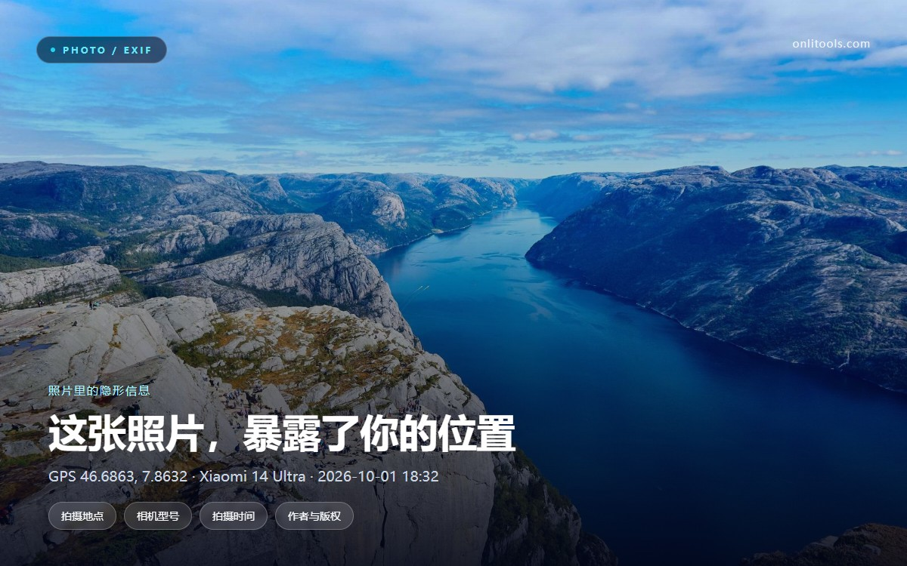
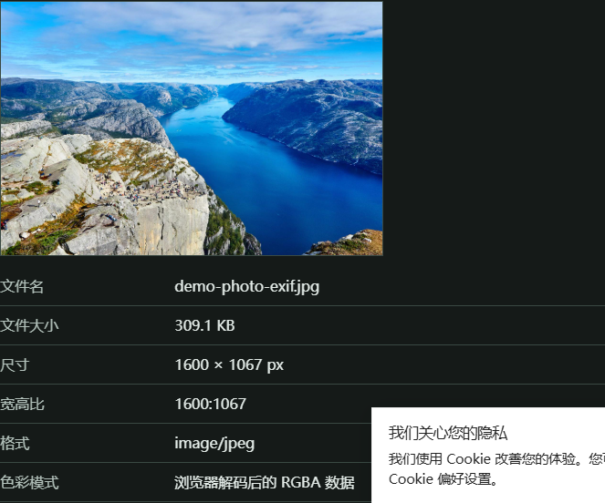
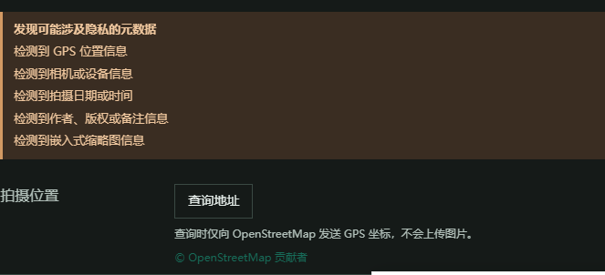
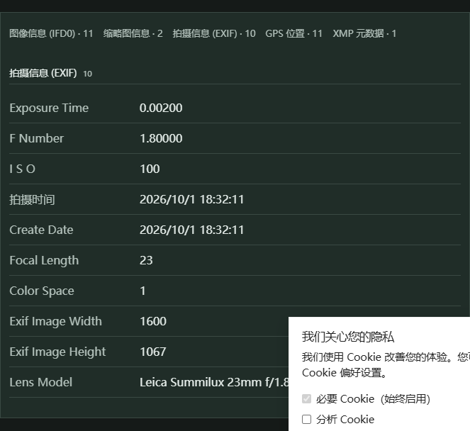

# 一张照片能看到多少信息？图片地址与 EXIF 隐私完全指南



我们每天都会把照片发出去：发到群里、贴到论坛、传进网盘、塞进简历附件。大多数人以为"发出去的就是我看到的画面"，但实际上，一张 JPEG 里常常还藏着一整套档案——拍摄地点、设备型号、精确到秒的时间、作者署名，甚至一张缩略图。

这篇文章分两部分讲清楚两件事：

1. **怎么查看一张图片的地址和基本信息**（它到底是什么文件）；
2. **一张照片里到底包含哪些隐私**，以及怎么把它们去掉。

文中所有截图都来自在线工具 [OnliTool 图片信息查看器](https://onlitools.com/zh/image-info)，它直接在浏览器本地解析文件，图片不会上传到服务器。

---

## 一、"图片地址"到底是什么

很多人说"查看图片地址"，其实指的可能是不一样的东西，先把概念分清：

**第一种：图片的 URL（网络地址）**

在网页上右键一张图，选择"复制图片地址"（或在图片上右键 →"在新标签页中打开图片"），地址栏里那一串就是图片的 URL。它长这样：

```
https://i0.hdslb.com/bfs/new_dyn/d1361d77a78bdc96c6d72f63f41de2d81127206971.png
```

光看这个地址，其实已经能读出不少东西：域名告诉你图片存在哪家 CDN、由哪个平台托管；路径里的目录名（`bfs/new_dyn`）暗示了上传业务；文件名往往是一串哈希值，说明平台在服务端做了重命名；有的站点还会在 URL 参数里带上尺寸、裁剪方式、过期时间。

**第二种：图片文件本身的信息**

这是本地文件层面的"身份信息"：文件名、文件大小、像素尺寸、宽高比、格式、色彩模式。这些不需要联网，也不需要上传，浏览器就能直接读出来。

OnliTool 的图片信息查看器做的就是第二种，同时还把 EXIF 一起读了出来。



上图是一张 309.1 KB 的 JPEG，1600 × 1067 px，宽高比 1600:1067。这些数字看着平淡，但它们能回答很多实际问题：

- 论坛限制上传 2 MB？先看文件大小，而不是反复压缩试错；
- 网页排版需要 16:9？先确认宽高比，避免裁切后主体被切掉；
- 收到一个 `.jpg` 却打不开？看真实格式，可能只是扩展名被改了。

---

## 二、照片里到底包含哪些隐私

真正容易被忽略的，是下面这部分：EXIF。

EXIF 是相机和手机在拍照时写进文件的一段元数据，原本是为了方便后期处理（记录光圈、快门、ISO、白平衡）。但手机厂商为了让照片"更聪明"，顺便把定位、设备、时间也写了进去。

用同一张图往下看，工具直接给出了一条醒目的提示：**检测到可能敏感的元数据**。



它列出了五类风险，逐条看：

**1. 位置信息（GPS）**

这是最危险的一项。EXIF 里的 GPS 纬度、经度通常是十进制度，精度足以定位到一栋楼。上面这张图的坐标是 `46.6863, 7.8632`——瑞士因特拉肯附近。如果你在家里阳台拍了一张照片原图发出去，等于把家庭住址一起发了。

更麻烦的是：GPS 是"可累积"的。同一个人在不同时间发的几张原图，拼起来就是一条活动轨迹——几点在公司、几点回家、周末去了哪里。

**2. 相机与设备信息**

相机厂商、相机型号、镜头型号、软件版本。看起来无害，实际能用来做设备指纹：知道你用的是 Xiaomi 14 Ultra、用的是 Adobe Lightroom 13.2 导出，再加上拍摄习惯，很容易和其他账号关联起来。

**3. 拍摄时间**

精确到秒的时间戳，加上 GPS，就能回答"这个人在什么时间出现在什么地点"。如果照片是家里拍的，还会顺带暴露作息规律。

**4. 作者与版权信息**

Artist、Copyright 字段。摄影师主动填写时是版权声明；但如果是从别人那里转存来的图，这两个字段可能还留着原作者的署名——这也算一种意外的"来源泄露"。

**5. 嵌入的缩略图**

JPEG 里可以嵌一张小尺寸缩略图（IFD1）。你以为自己用马赛克、裁剪盖住了敏感内容，但缩略图可能还是原始未处理的版本。这是最隐蔽的一类问题，普通看图软件根本不显示。

---

## 三、点开"技术详情"，能看到 35 项

界面上默认只展示常用字段，点开"技术详情"，可以看到完整的 35 项元数据，并按 IFD0、缩略图、EXIF 拍摄信息、GPS、XMP 分组。



按分组理解会更清楚：

- **Image information (IFD0)**：图像基础属性，宽高、分辨率单位、方向、色彩空间；
- **Thumbnail information**：嵌入缩略图的存在与尺寸（就是前面说的隐藏版本）；
- **Capture information (EXIF)**：曝光时间、光圈、ISO、焦距、测光模式、闪光灯；
- **GPS location**：纬度、经度、海拔、拍摄方向，以及 GPS 时间戳；
- **XMP metadata**：Adobe 系的扩展元数据，可能包含编辑历史、评级、关键词。

同一个界面里还有个"查询地址"按钮，可以把经纬度反查成人类可读的地名，方便你判断这条坐标到底精确到什么程度。

---

## 四、这些信息是怎么流出去的

关键点在于：**不同渠道对 EXIF 的处理完全不一样。**

- **社交平台（微信、微博、小红书等）**：上传时通常会在服务端重新压缩，并剥离大部分 EXIF，包括 GPS。所以朋友圈原图的风险相对低，但这依赖平台策略，不是你能控制的。
- **邮件附件、网盘、论坛附件、即时通讯的"文件"发送**：往往原样传输，EXIF 一个字节都不少。
- **自己搭的图床、Git 仓库、静态站点**：默认保留原图，元数据完整保留。
- **截图**：截图是重新生成的图像，天然不带相机 EXIF。这是最简单有效的"去元数据"方式。

所以"我发的只是照片，不是位置"这个想法，在原图传输的场景下是不成立的。

---

## 五、怎么查看和清理

**查看（三步）**

1. 打开 [图片信息查看器](https://onlitools.com/zh/image-info)；
2. 把图片拖进去，或点"添加图片"选择文件；
3. 先看文件名/大小/尺寸，再看隐私提示，需要细节就展开"技术详情"。

整个过程在浏览器本地完成，图片不会被上传——这一点对"检查敏感照片"尤其重要，因为你不会为了检查隐私，先把隐私传给一个陌生服务器。

**清理（按可靠性排序）**

1. **截图代替原图**：最彻底，元数据全部重新生成；
2. **导出时去掉元数据**：Lightroom 导出勾选"删除位置信息"，Photoshop 用"导出为"而不是"存储为"；
3. **用系统或工具批量清除**：Windows 资源管理器 → 属性 → 详细信息 →"删除属性和个人信息"；macOS 可用 `exiftool -all= photo.jpg`；
4. **相机设置里关掉定位**：从源头减少，而不是每次事后补救。

一个实用习惯：**发之前先看一眼**。检查成本只有几秒钟，而一次位置泄露是不可撤回的。

---

## 六、工具信息

- 工具地址：[https://onlitools.com/zh/image-info](https://onlitools.com/zh/image-info)
- 处理方式：浏览器本地解析，不上传服务器
- 支持：JPEG / PNG / WebP 等常见格式，可读取 EXIF、GPS、XMP 与嵌入缩略图
- 适合场景：发图前自查、排查图片打不开的原因、确认尺寸与格式、检查是否残留作者信息

---

**说明**：本文截图中的照片是专门生成的演示图，其中的 GPS 坐标、设备型号、拍摄时间、作者署名均为虚构数据，仅用于展示元数据字段的形态，与任何真实个人无关。
